<div align="center">

# 🏎️ GPRO Setup Tool

**Setup, fuel and part wear calculator for Grand Prix Racing Online managers**

### [▶ Try the live demo: gpro-setup-tool.vercel.app](https://gpro-setup-tool.vercel.app)

[](https://gpro-setup-tool.vercel.app)
[](https://wa.me/393516248936?text=Hi%20Andrea%2C%20I%20tried%20the%20GPRO%20Setup%20Tool%20demo%20and%20I%27d%20like%20information%20about%20my%20personalized%20version.)

[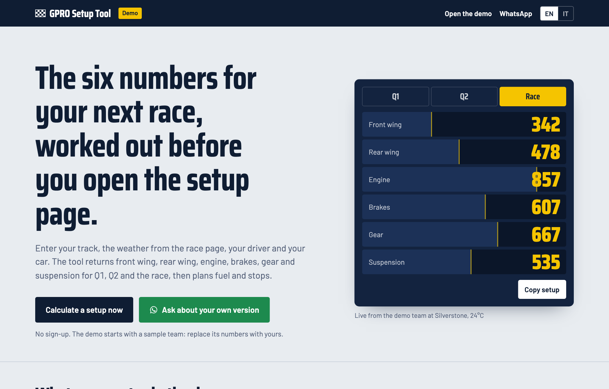](https://gpro-setup-tool.vercel.app)

English and Italian · No sign-up · Works on phone and desktop

</div>

---

## 🏁 What the demo does

Open the demo, connect with the demo GPRO token (or type your own numbers) and get the setup to enter in the game.

- **Import from GPRO**: connect with a GPRO API token and driver, car, staff, weather and past races fill in by themselves. In the demo the connection is simulated on a sample team.
- **Setup for Q1, Q2 and race**: front wing, rear wing, engine, brakes, gear and suspension, from track, temperature, dry or wet, driver skills and the level and wear of all 11 car parts, with a breakdown of why each number is what it is.
- **Practice lap corrector**: enter the driver comments after each practice lap; the tool narrows the right value for every part and suggests the next lap.
- **Fuel and pit stops**: stops, laps per stint, litres per stint and time lost for every compound, plus a fuel safety coach that shows what extra litres cost.
- **Part wear**: wear for this race and a plan over the next races, with the race before which to replace each part.
- **Season and calibration**: predicted against actual for fuel, stops and wear, and setup offsets learned from the races that worked for you.

The demo starts with a sample team and calculates the sample race plus **one track of your choice**, so you can check it on your own next race.

| Connect GPRO | Race weekend |
|---|---|
| [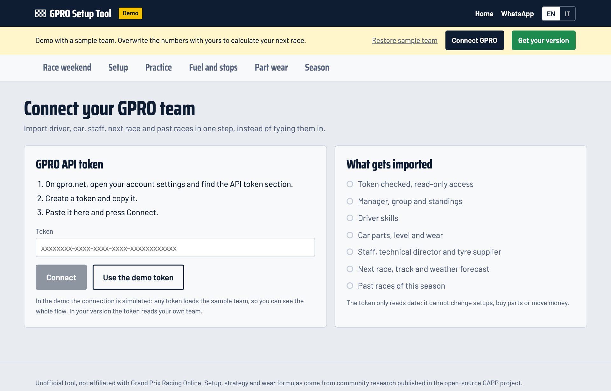](https://gpro-setup-tool.vercel.app/#/app/connect) | [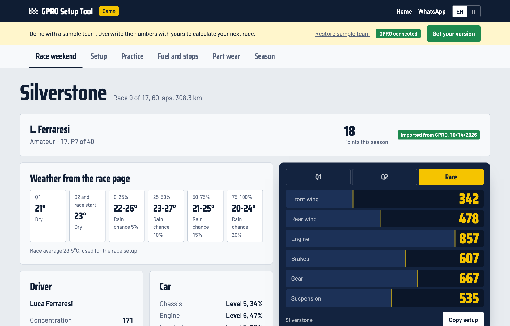](https://gpro-setup-tool.vercel.app/#/app/weekend) |

| Setup calculator | Why these numbers |
|---|---|
| [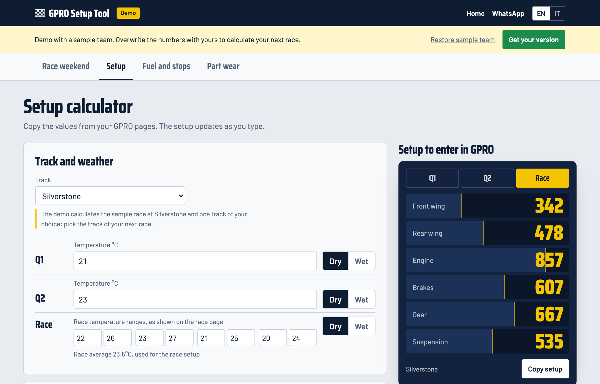](https://gpro-setup-tool.vercel.app/#/app/setup) | [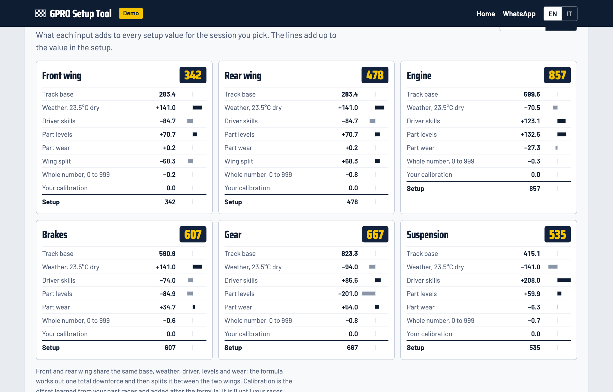](https://gpro-setup-tool.vercel.app/#/app/setup) |

| Practice lap corrector | Season and calibration |
|---|---|
| [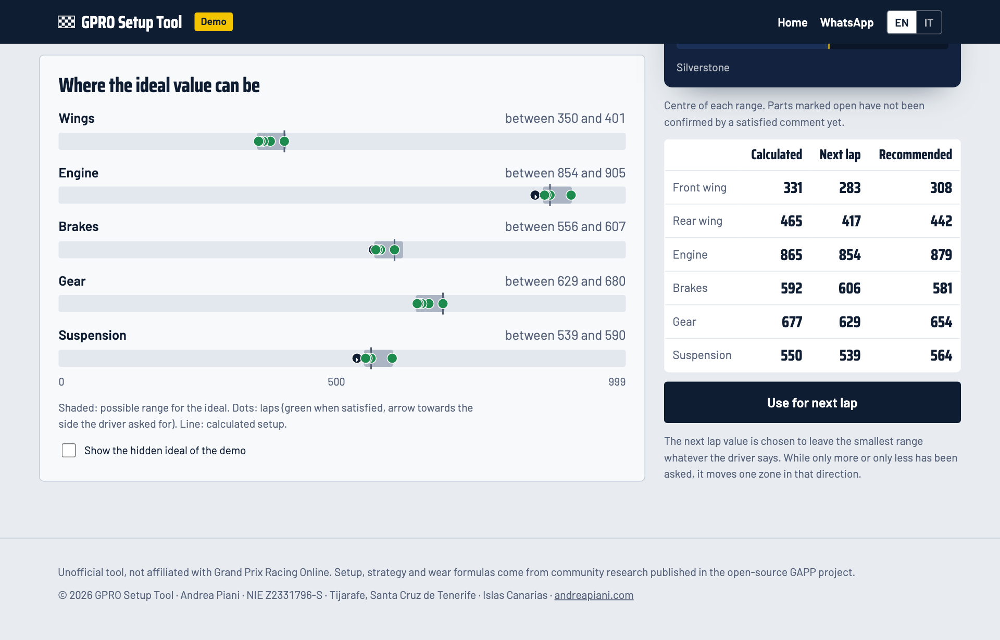](https://gpro-setup-tool.vercel.app/#/app/practice) | [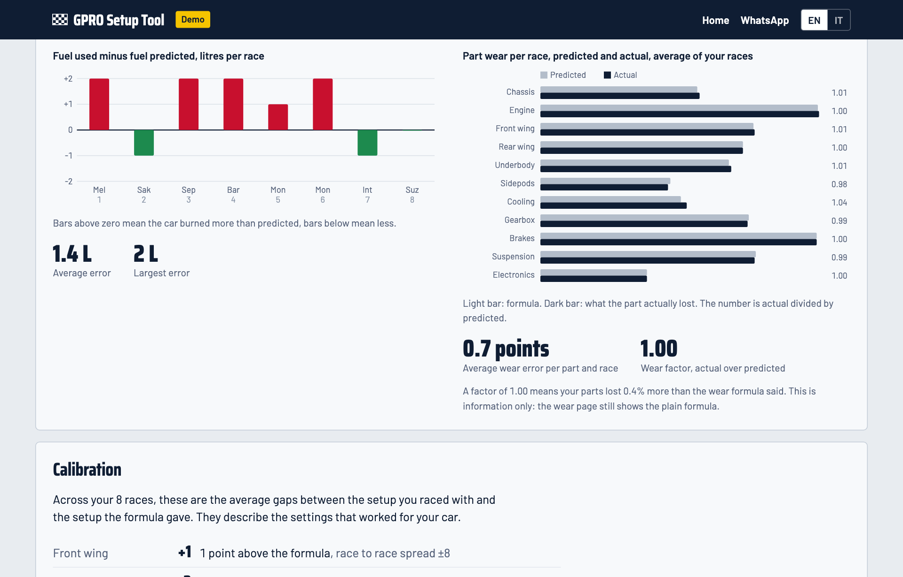](https://gpro-setup-tool.vercel.app/#/app/season) |

| Fuel and pit stops | Part wear |
|---|---|
| [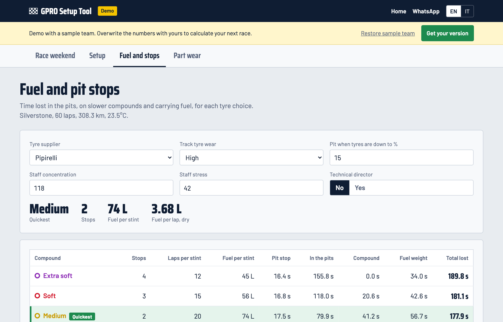](https://gpro-setup-tool.vercel.app/#/app/strategy) | [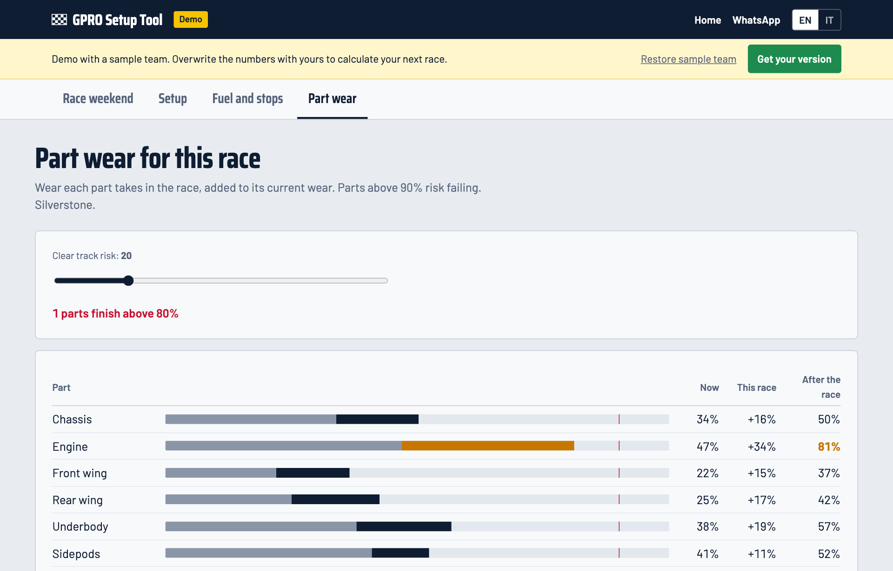](https://gpro-setup-tool.vercel.app/#/app/wear) |

<p align="center">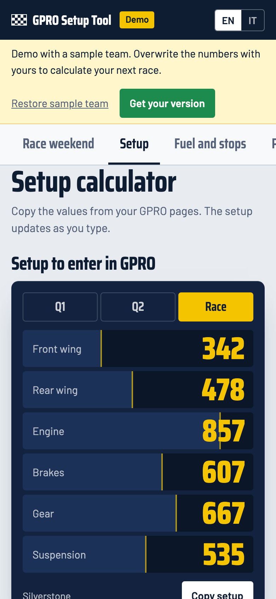</p>

## 🔧 Your personalized version

- All GPRO tracks, on your own private instance, in English or Italian
- Formulas checked against your recent races, so the numbers match your car
- Your team saved, race history, and features adapted to the way you manage
- **250 € one-time**, then 50 € a year from the second year for hosting and updates; ready in 2 working days, regular invoice

📲 **Write to me on WhatsApp: [+39 351 624 8936](https://wa.me/393516248936?text=Hi%20Andrea%2C%20I%20tried%20the%20GPRO%20Setup%20Tool%20demo%20and%20I%27d%20like%20information%20about%20my%20personalized%20version.)**. Tell me your GPRO group and what you would like the tool to do for you.

Made by [Andrea Piani](https://www.andreapiani.com), for GPRO enthusiasts. Setup, strategy and wear formulas come from community research published in the open-source [GAPP](https://github.com/Whompratt/GAPP) project. Unofficial tool, not affiliated with Grand Prix Racing Online.

---

## 📦 About the code in this repository

**This repository holds the first, free version of the tool (MVP), not the code of the live demo.** It runs on sample data, its setup calculations are placeholders and some features are missing. The live demo and the personalized versions are a separate, newer product.

| Old free version: dashboard | Old free version: calculator |
|---|---|
| 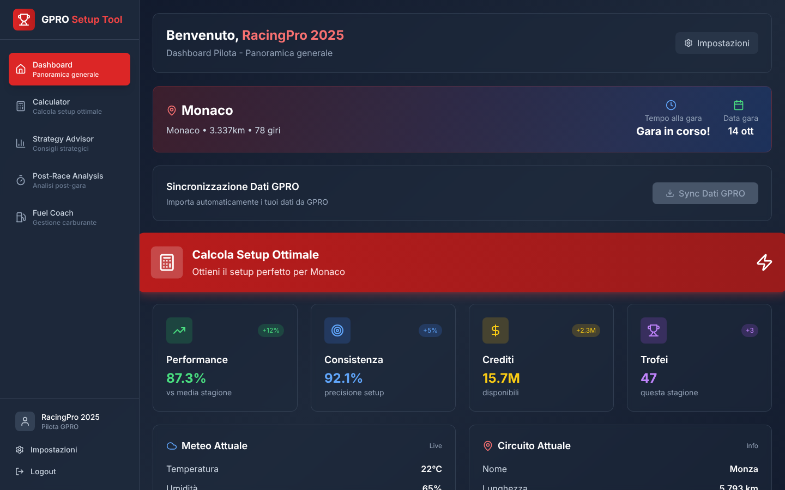 | 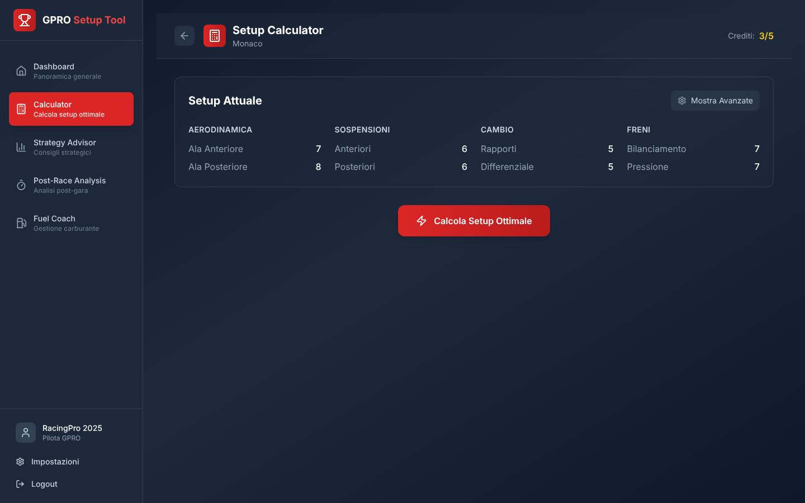 |

## ✨ Key Features

### Core Features
- **🔧 Automatic Excel Generation**: Creates complete Excel files with 5 specialized calculation sheets
- **⚡ Advanced Calculations**: Smart algorithms for setup optimization (currently simulated for MVP)
- **🎨 Modern Interface**: Responsive UI built with React and custom racing-themed Tailwind CSS
- **🚀 High Performance Backend**: Node.js APIs optimized for rapid file generation
- **☁️ Cloud Deployment**: High-performance hosting on Vercel with PWA capabilities
- **🔒 User Authentication**: Secure Supabase auth with trial and premium credit system
- **📊 Strategy Planning**: Fuel calculations, tyre strategy, and pit stop optimization
- **📈 Race Analysis**: Post-race performance comparison and insights

### 🚀 Revolutionary New Features (Industry First!)

- **🏆 AI-Powered Qualifying Simulator**: Predicts grid position with machine learning, analyzes competitors, and optimizes Q1/Q2 strategy with track evolution modeling
- **🔧 Predictive Parts Wear Calculator**: ML-based wear prediction across multiple races, ROI analysis for upgrades, budget optimization, and failure risk assessment
- **⚡ Overtaking Risk/Reward Matrix**: Revolutionary AI decision matrix for overtaking, calculates success probability, incident risk, and expected value for each opportunity
- **📊 Advanced Analytics Dashboard**: Real-time visualization of all simulations with interactive results and professional motorsport-themed UI

## 📊 How Excel Generation Works

The system uses the **ExcelJS** library to create dynamic Excel files with professional motorsport styling:

<div align="center">

### 📋 Excel File Structure

| Sheet | Purpose | Content |
|-------|---------|---------|
| 🏁 **Input** | Race Parameters | Driver, car, track, and weather data |
| ⚙️ **Setup** | Optimal Settings | Q1/Q2/Race setup calculations with confidence levels |
| 🏎️ **Strategy** | Race Planning | Fuel consumption, pit stops, and tyre strategy |
| 📈 **Simulations** | Scenario Analysis | Multiple strategy comparisons and crossover analysis |
| 📊 **Post-Race** | Performance Review | Predicted vs actual results comparison |

</div>

### 🛠️ Technical Implementation

```typescript
// Professional motorsport styling
const workbook = new ExcelJS.Workbook();
const worksheet = workbook.addWorksheet('Setup');

// Racing color palette
worksheet.getCell('A1').fill = {
  type: 'pattern',
  pattern: 'solid',
  fgColor: { argb: 'FF1E40AF' } // GPRO Blue
};

// Freeze panes for better navigation
worksheet.views = [{ state: 'frozen', ySplit: 3 }];
```

### ⚡ Performance Metrics

- **📁 File Size**: < 500KB
- **⏱️ Generation Time**: < 2 seconds  
- **💾 Format**: Excel 2007+ (.xlsx)
- **✅ Compatibility**: All major Excel clients

## 🚀 Revolutionary AI Features

### 🏆 Qualifying Simulator
**Industry's First AI-Powered Grid Prediction System**

<div align="center">

| Feature | Description | Innovation Level |
|---------|-------------|------------------|
| **Grid Position AI** | ML-powered prediction of qualifying position | 🔥 Revolutionary |
| **Competitor Analysis** | Real-time threat assessment of other drivers | 🔥 Revolutionary |
| **Track Evolution** | Dynamic grip modeling from Q1 to Q2 | 🔥 Revolutionary |
| **Risk Assessment** | Weather, traffic, and setup risk factors | 🔥 Revolutionary |
| **Strategy Optimization** | Fuel, tyre, and push level optimization | 🔥 Revolutionary |

</div>

```typescript
// Example: AI prediction output
const result = qualifyingSimulator.simulateQualifying(snapshot);
console.log(`Predicted Grid: P${result.predictedPosition}`);
console.log(`Q1 Time: ${result.q1Time}`);
console.log(`Q2 Time: ${result.q2Time}`);
console.log(`Confidence: ${result.confidence}%`);
```

### 🔧 Parts Wear Calculator
**ML-Based Predictive Maintenance System**

<div align="center">

| Feature | Description | Business Value |
|---------|-------------|----------------|
| **Wear Prediction** | Multi-race parts degradation forecasting | 💰 High ROI |
| **Budget Optimization** | Cost vs performance analysis | 💰 High ROI |
| **Failure Risk** | Exponential risk calculation per component | 💰 High ROI |
| **Maintenance Planning** | Optimal replacement scheduling | 💰 High ROI |
| **ROI Analysis** | Investment return for each upgrade | 💰 High ROI |

</div>

```typescript
// Example: Parts analysis output
const analysis = partsWearCalculator.analyzePartsWear(snapshot, 10);
console.log(`Total Maintenance Cost: €${analysis.maintenancePlan.totalCost}`);
console.log(`Efficiency Score: ${analysis.budgetAnalysis.efficiencyScore}/100`);
console.log(`Potential Savings: €${analysis.maintenancePlan.costSavings}`);
```

### ⚡ Overtaking Risk/Reward Matrix  
**Revolutionary Decision Support System**

<div align="center">

| Feature | Description | Competitive Edge |
|---------|-------------|------------------|
| **Success Probability** | AI-calculated overtaking chances | 🏆 Game Changer |
| **Risk Assessment** | Incident probability analysis | 🏆 Game Changer |
| **Expected Value** | Points gain/loss calculation | 🏆 Game Changer |
| **DRS Analysis** | Zone-specific overtaking data | 🏆 Game Changer |
| **Technique Selection** | Optimal overtaking method | 🏆 Game Changer |

</div>

```typescript
// Example: Overtaking analysis output  
const analysis = overtakingSimulator.analyzeOvertaking(snapshot, 8, 25, 53);
console.log(`Risk Score: ${analysis.riskMatrix.riskScore}/100`);
console.log(`Reward Score: ${analysis.riskMatrix.rewardScore}/100`);
console.log(`Strategy: ${analysis.riskMatrix.recommendation}`);
```

### 📊 Key Innovations

<div align="center">

**🎯 What Makes These Features Revolutionary:**

| Innovation | Traditional Tools | GPRO Setup Tool |
|------------|-------------------|-----------------|
| **Qualifying Prediction** | ❌ Not Available | ✅ AI-Powered Grid Position |
| **Parts Management** | ❌ Basic Tracking | ✅ ML Predictive Analytics |
| **Overtaking Decisions** | ❌ Manual Intuition | ✅ Risk/Reward Matrix |
| **Data Integration** | ❌ Static Calculations | ✅ Dynamic Simulations |
| **User Experience** | ❌ Spreadsheet-Based | ✅ Modern Interactive UI |

</div>

## ⚠️ MVP Status - Simulated Functions

> **IMPORTANT**: This is an MVP (Minimum Viable Product) with **completely simulated data and calculations**.

<div align="center">

### 🎯 Currently Simulated Features

| Feature | Status | Implementation |
|---------|--------|---------------|
| ⚙️ Setup Optimization | 🟡 Simulated | Advanced algorithms planned |
| 🏁 Race Strategy | 🟡 Simulated | Real GPRO data integration coming |
| 📊 Performance Analysis | 🟡 Simulated | Historical data analysis planned |
| 🌤️ Weather & Track Data | 🟡 Simulated | Live API integration planned |
| 👨‍💼 Driver & Car Stats | 🟡 Simulated | GPRO profile sync planned |
| 🏆 **Qualifying Simulator** | ✅ **MVP Complete** | AI-powered grid prediction with competitor analysis |
| 🔧 **Parts Wear Calculator** | ✅ **MVP Complete** | ML-based wear prediction and budget optimization |
| ⚡ **Overtaking Matrix** | ✅ **MVP Complete** | Risk/reward analysis with success probability AI |
| 📊 **Advanced Dashboard** | ✅ **MVP Complete** | Interactive UI for all simulation results |

</div>

### 🎯 MVP Goals

- ✅ **System Architecture**: Demonstrate full-stack capabilities
- ✅ **User Experience**: Test interface and workflow
- ✅ **Excel Generation**: Validate professional output format
- ✅ **Community Feedback**: Gather input from GPRO managers

> **Real calculations will be implemented with GPRO community contributions!**

## 🛠️ Tech Stack

<div align="center">

### Frontend Architecture

| Technology | Version | Purpose |
|-----------|---------|---------|
| **React** | 18.3.1 | Modern UI framework |
| **TypeScript** | 5.8.3 | Type safety & developer experience |
| **Vite** | 6.0.1 | Lightning-fast build tool & dev server |
| **TailwindCSS** | 3.4.17 | Utility-first styling with racing theme |
| **Zustand** | 5.0.3 | Lightweight state management |
| **React Router** | 7.3.0 | Client-side routing with protected routes |

### Backend & Services

| Technology | Purpose | Features |
|-----------|---------|----------|
| **Supabase** | Backend-as-a-Service | Auth, database, real-time subscriptions |
| **Express.js** | API server | Excel generation and additional endpoints |
| **ExcelJS** | Excel manipulation | Professional motorsport-styled spreadsheets |
| **Vercel** | Cloud hosting | Serverless deployment with global CDN |

</div>

### 🏗️ Architecture Highlights

- **📱 Progressive Web App** with offline capabilities
- **🔐 Secure Authentication** with Supabase Auth
- **💾 Type-safe Database** with generated TypeScript types
- **⚡ Optimized Builds** with Vite chunking strategy
- **🎨 Custom Design System** with racing-themed components

## 🚀 Quick Start

<div align="center">

### Prerequisites


</div>

### 📦 Installation

```bash
# Clone the repository
git clone https://github.com/andreapianidev/GPRO-Setup-Tool.git
cd gpro-setup-tool

# Install dependencies
npm install

# Start development server
npm run dev

# Build for production
npm run build

# Preview production build
npm run preview
```

### 🔧 Environment Setup

Create a `.env.local` file in the project root:

```env
# Supabase Configuration
VITE_SUPABASE_URL=your_supabase_project_url
VITE_SUPABASE_ANON_KEY=your_supabase_anon_key

# Development
NODE_ENV=development
```

### 🖥️ Development Commands

| Command | Description |
|---------|-------------|
| `npm run dev` | Start development server (localhost:3000) |
| `npm run build` | Build for production |
| `npm run preview` | Preview production build |
| `npm run lint` | Run ESLint |
| `npm run check` | TypeScript type checking |

## 📁 Project Structure

```
gpro-setup-tool/
├── 📂 src/                    # React frontend application
│   ├── 🧩 components/         # Reusable UI components
│   ├── 📄 pages/              # Application pages and routes
│   │   └── 🚀 AdvancedTools.tsx  # Revolutionary AI simulation dashboard
│   ├── 🔧 services/           # API integration and business logic
│   │   ├── 🏆 qualifyingSimulator.ts    # AI-powered qualifying prediction
│   │   ├── 🔧 partsWearCalculator.ts    # ML-based parts wear analysis
│   │   ├── ⚡ overtakingSimulator.ts     # Risk/reward overtaking matrix
│   │   ├── ⚙️ setupCalculator.ts        # Core setup optimization
│   │   └── 📊 strategyCalculator.ts     # Race strategy planning
│   ├── 🪝 hooks/              # Custom React hooks
│   ├── 🏪 lib/                # Utilities, stores, and configurations
│   └── 📝 types/              # TypeScript type definitions
├── 📂 api/                    # Express.js backend
│   ├── 📊 excel/              # Excel file generation logic
│   ├── 🛣️ routes/             # API route handlers
│   └── ⚙️ app.ts              # Express server configuration
├── 📂 public/                 # Static assets and PWA icons
├── 📂 docs/                   # Project documentation
└── 📂 dist/                   # Production build output
```

<div align="center">

### 🏗️ Key Directories

| Directory | Purpose | Contains |
|-----------|---------|----------|
| `/src/components` | UI Components | Reusable React components with racing theme |
| `/src/pages` | Application Pages | Route-based page components |
| `/src/types` | Type Definitions | Complete GPRO domain models |
| `/src/lib` | Core Logic | Zustand stores, Supabase client, utilities |
| `/api/excel` | Excel Generation | Professional motorsport Excel templates |

</div>

## 🤝 Contributing

<div align="center">

**We're looking for passionate GPRO managers and developers to join our community!**

[](http://makeapullrequest.com)
[](https://github.com/andreapianidev/GPRO-Setup-Tool/issues?q=is%3Aissue+is%3Aopen+label%3A%22good+first+issue%22)

</div>

### 🎯 Contribution Areas

| Area | Description | Skills Needed |
|------|-------------|---------------|
| 🧮 **GPRO Algorithms** | Implement real calculation logic | GPRO knowledge, Mathematics |
| 🤖 **AI/ML Enhancement** | Improve simulation algorithms | Machine Learning, Data Science |
| 🎨 **UI/UX Design** | Enhance user interface | React, TailwindCSS, Design |
| ⚡ **Performance** | Optimize backend & frontend | Node.js, React optimization |
| 🧪 **Testing** | Add automated test coverage | Jest, Testing Library |
| 📚 **Documentation** | Create guides and tutorials | Technical writing |
| 🔍 **Data Analysis** | Validate simulation accuracy | Statistics, GPRO expertise |

### 🚀 How to Contribute

```bash
# 1. Fork the repository on GitHub
# 2. Clone your fork
git clone https://github.com/andreapianidev/GPRO-Setup-Tool.git

# 3. Create a feature branch
git checkout -b feature/amazing-feature

# 4. Make your changes and commit
git commit -m 'Add amazing feature'

# 5. Push to your branch
git push origin feature/amazing-feature

# 6. Open a Pull Request
```

### 📋 Contribution Guidelines

- ✅ Follow existing TypeScript and React patterns
- ✅ Add tests for new features
- ✅ Update documentation for significant changes
- ✅ Follow the existing code style (ESLint/Prettier)
- ✅ Reference issues in your commit messages

## 🎯 Roadmap

<div align="center">

### Development Phases

| Phase | Status | Features | Timeline |
|-------|---------|----------|----------|
| **🚀 Phase 1 - MVP** | ✅ Complete | UI, Excel generation, deployment | Q1 2024 |
| **🔍 Phase 2 - Real Data** | 🔄 In Progress | GPRO algorithms, real integration | Q2 2024 |
| **⭐ Phase 3 - Advanced** | 📋 Planned | Public API, sharing, analytics | Q3 2024 |

</div>

### ✅ Phase 1 - MVP (Completed)
- ✅ **Modern UI**: React + TailwindCSS with racing theme
- ✅ **Excel Generation**: Professional 5-sheet workbooks
- ✅ **Authentication**: Supabase auth with credit system
- ✅ **Cloud Deployment**: Vercel hosting with PWA features
- ✅ **🚀 Revolutionary AI Tools**: Industry-first GPRO simulation features
  - ✅ **Qualifying Simulator**: AI-powered grid prediction with competitor analysis
  - ✅ **Parts Wear Calculator**: ML-based predictive maintenance with ROI optimization
  - ✅ **Overtaking Matrix**: Risk/reward analysis with success probability calculations
  - ✅ **Advanced Dashboard**: Interactive UI for all simulation results

### 🔄 Phase 2 - Real Data Integration
- 🔄 **GPRO API Integration**: Live data synchronization  
- 🔄 **Real Algorithms**: Community-driven calculation logic
- 🔄 **Validation System**: Compare predictions vs results
- 📋 **Historical Analysis**: Track performance over time

### 📋 Phase 3 - Advanced Features  
- 📋 **Public API**: Allow third-party integrations
- 📋 **Setup Sharing**: Community setup database
- 📋 **Advanced Analytics**: ML-powered insights
- 📋 **Mobile App**: Native iOS/Android applications

## 🖼️ Screenshots

<div align="center">

### 🏁 Application Interface
*Professional racing-themed UI with real-time data*

### 📊 Generated Excel Output  
*5-sheet professional workbook with motorsport styling*

### ⚡ Workflow Process
```
🏎️ Input Data → 🧮 Calculate Setup → 📊 Generate Excel → ⬇️ Download
```

</div>

## 👨‍💻 Author

<div align="center">

**Created with ❤️ by**

[](https://www.andreapiani.com)
[](https://linkedin.com/in/andreapiani)

</div>

### 🙏 Acknowledgments

- 🏁 **GPRO Community** for inspiration and domain knowledge
- 🤝 **Open Source Contributors** who make this project better
- ⚡ **Vercel Team** for excellent hosting platform
- 🎨 **TailwindCSS Team** for the amazing styling framework

## 📄 License

<div align="center">

[](https://creativecommons.org/licenses/by-nc/4.0/)

**Creative Commons Attribution-NonCommercial 4.0 International**

</div>

This project is licensed under **CC BY-NC 4.0** - see the [LICENSE](LICENSE) file for details.

**Key Points:**
- ✅ **Free for personal use** and non-commercial projects
- ✅ **Attribution required** - please credit [Andrea Piani](https://www.andreapiani.com)
- ❌ **Commercial use prohibited** without explicit permission
- 📞 **Commercial licensing and updated version available** - WhatsApp [+39 351 624 8936](https://wa.me/393516248936) or [www.andreapiani.com](https://www.andreapiani.com)

## 🔗 Quick Links

<div align="center">

| Link | Description |
|------|-------------|
| [💬 **WhatsApp**](https://wa.me/393516248936) | Updated version, customization & support |
| [📊 **GitHub Repository**](https://github.com/andreapianidev/GPRO-Setup-Tool) | Source code |
| [🐛 **Report Issues**](https://github.com/andreapianidev/GPRO-Setup-Tool/issues) | Bug reports & feature requests |
| [💬 **WhatsApp**](https://wa.me/393516248936) | Questions and the personalized version |
| [🌐 **Author Website**](https://www.andreapiani.com) | More projects & contact |

</div>

---

<div align="center">

**⭐ If this project helps you, please give it a star on GitHub! ⭐**

**🤝 Join our community and help improve the tool for all GPRO managers! 🏎️**

*Made with ❤️ for the GPRO community*

</div>